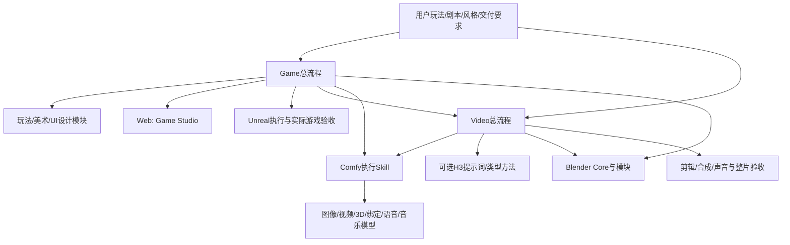

# 工程结构与职责

```text
lightstory-workflows/
├─ skills/                  自主总流程、Comfy执行及游戏创作/动作适配
├─ workflows/               按模型/功能组织的UI、API、节点/模型需求与目录
├─ adapters/                自主Comfy节点、保护器、3D检查和Motion工具
├─ src/lightstory/          统一配置、查询、安装、下载、诊断和运行入口
├─ config/                  可公开的机器配置示例；local.json由用户维护并忽略
├─ models/                  权重来源、版本、哈希与派生转换记录，实际权重不入库
├─ third_party/
│  ├─ dependencies.lock.json 固定第三方Git/文件版本与补丁
│  ├─ skills/blender-skills/ MIT第三方快照及本地兼容适配
│  ├─ overlays/minimax-h3/   本项目自写的运行映射；官方正文外部获取
│  ├─ patches/              对固定第三方基线的最小补丁
│  └─ licenses/             第三方许可证原文
├─ docs/                    安装、使用、架构、边界和维护
│  └─ film/                 产品介绍播放器；assets内仅存正式成片、海报、字幕
├─ media/product-film/      产品介绍片的可编辑源、视觉规范、运行库与许可
├─ manifests/               导入来源与移植改动记录
├─ tools/                   源码运行、维护导出和文档生成入口
├─ tests/                   无GPU、无用户素材的隔离测试
└─ .lightstory/             用户本地状态、组装依赖、任务请求和运行资料（忽略）
```

## 内容归属

| 内容 | 收纳方式 | 更新入口 |
|---|---|---|
| Game/Video总方法、项目模板 | `skills/<总流程>` | 直接在仓库修改；执行细节留对应执行层 |
| 玩法、美术、UI模块 | `skills/game-*`，保留来源许可 | 保留上游NOTICE，记录自己的适配 |
| 通用模型选配/运行说明 | `skills/comfyui-local-workflows` | 与相关画布和节点版本一起审查 |
| 通用画布 | `workflows/ui`与`workflows/api`，共享目录登记 | 改节点同步两者；不夹带项目素材 |
| 本地自主适配代码 | `adapters`、`src` | 修改代码并测试受影响行为 |
| 第三方节点与Motion后端 | 固定版本外部获取至配置的共享tools目录，再链接原生节点位置 | 先改lock、审查差异，再处理patch |
| Blender第三方技能 | 带MIT许可的固定源码快照 | 在独立分支对照上游，保留本地适配 |
| H3官方类型技能 | 固定Git提交+自写overlay，本地获取/组装 | 原文不改，本机映射独立维护 |
| 客户端原生插件 | 插件ID与安装/能力说明 | 由使用者在对应客户端安装、登录和连接 |
| 权重/受限模型 | 版本、来源、SHA与取得说明 | 用户自行取得；不纳入Git |
| 原始验证工程和样片 | 各使用者本地保留；公开包只给去路径摘要和验证方法 | 新作品按本项目记录验收 |
| 产品介绍视频 | `docs/film`发布文件；`media/product-film`编辑源 | 相关发布文件推送后自动部署；完成线上播放检查 |

## 分层调用



总流程管理目标、阶段和整体验收；执行层负责具体工具、参数、产物和局部检查。跨层共用项目ID、素材版本及依赖，不互相递归立项。Web与UE、实拍与生成、CG与后期均按需求选择。

## 机器与项目隔离

仓库可放任意磁盘；`config/local.json`或`LIGHTSTORY_CONFIG`指向机器配置，`LIGHTSTORY_ROOT`可显式定位源码。模型、工具和原生画布保持各自管理位置。新制作项目放配置的`projects_root`或用户指定目录，项目脚本、下载、日志、临时文件和交付物集中收纳。

`.lightstory`包含已安装Skill可能链接到的组装结果及服务状态，不能整目录当缓存清空。临时数据按任务归属清理；源码和实际依赖由维护规则保护。

`state_root/installed/workflows.json`登记原生UI副本与来源；`runtime/cache/h3`保存分段返工缓存。可选的本机历史档案也不进入Git，新安装无需具备历史档案。
